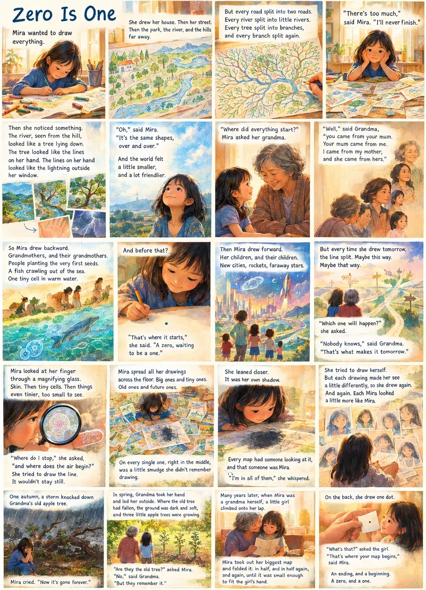

*To future children, like Vicky and Ricky*

By [Isaac Mao](https://isaacmao.com/). Anyone is welcome to retell this story or make new creative works from it. Please link to [this page](https://isaacmao.com/zero-is-one/) and credit **Isaac Mao** and his philosophical framework, [Recursive Emergence](https://recursive-emergence.github.io/RE/) ([GitHub](https://github.com/Recursive-Emergence/RE)).

This is a story for children, and for anyone who still likes to wonder. You can read it in pictures or in words. Both tell the same story.

**About the picture:** the story is my own idea, but the image was generated by OpenAI.

## The story

Mira wanted to draw everything.

She drew her house. Then her street. Then the park, the river, and the hills far away. But every road split into two roads. Every river split into little rivers. Every tree split into branches, and every branch split again.

"There's too much," said Mira. "I'll never finish."

Then she noticed something. The river, seen from the hill, looked like a tree lying down. The tree looked like the lines on her hand. The lines on her hand looked like the lightning outside her window.

"Oh," said Mira. "It's the same shapes, over and over."

And the world felt a little smaller, and a lot friendlier.

"Where did everything start?" Mira asked her grandma.

"Well," said Grandma, "you came from your mum. Your mum came from me. I came from my mother, and she came from hers."

So Mira drew backward. Grandmothers, and their grandmothers. People planting the very first seeds. A fish crawling out of the sea. One tiny cell in warm water.

And before that?

Mira drew a small dot. "That's where it starts," she said. "A zero, waiting to be a one."

Then Mira drew forward. Her children, and their children. New cities, rockets, faraway stars.

But every time she drew tomorrow, the line split. Maybe this way. Maybe that way.

"Which one will happen?" she asked.

"Nobody knows," said Grandma. "That's what makes it tomorrow."

Mira looked at her finger through a magnifying glass. Skin. Then tiny cells. Then things even tinier, too small to see.

"Where do I stop," she asked, "and where does the air begin?"

She tried to draw the line. It wouldn't stay still.

Mira spread all her drawings across the floor. Big ones and tiny ones. Old ones and future ones.

On every single one, right in the middle, was a little smudge she didn't remember drawing.

She leaned closer.

It was her own shadow.

Every map had someone looking at it, and that someone was Mira. "I'm in all of them," she whispered.

She tried to draw herself. But each drawing made her see a little differently, so she drew again. And again. Each Mira looked a little more like Mira.

One autumn, a storm knocked down Grandma's old apple tree.

Mira cried. "Now it's gone forever."

In spring, Grandma took her hand and led her outside. Where the old tree had fallen, the ground was dark and soft, and three little apple trees were growing.

"Are they the old tree?" asked Mira.

"No," said Grandma. "But they remember it."

Many years later, when Mira was a grandma herself, a little girl climbed onto her lap.

Mira took out her biggest map and folded it: in half, and in half again, and again, until it was small enough to fit in the girl's hand.

On the back, she drew one dot.

"What's that?" asked the girl.

"That's where your map begins," said Mira.

An ending, and a beginning.

A zero, and a one.

## Things to wonder about

- Can you find a shape that repeats? Try a leaf, a river on a map, or the lines on your hand.
- Draw your family backward. How far back can you go?
- Now draw tomorrow. How many ways could it go?
- Where do *you* stop, and where does the air begin?
- The little apple trees are not the old tree, but they remember it. What do you remember from someone, or something, that is gone?

## For grown-ups

*Zero Is One* is my children's telling of [Recursive Emergence](https://recursive-emergence.github.io/RE/), though the story never names it. Four ideas sit inside it: the same patterns repeat at every scale; everything comes from somewhere, and the future keeps branching; the self is the one looking at every map; and endings feed beginnings without being the same thing.

The story doesn't explain any of this, and it doesn't need to. Children can feel it without being told.
